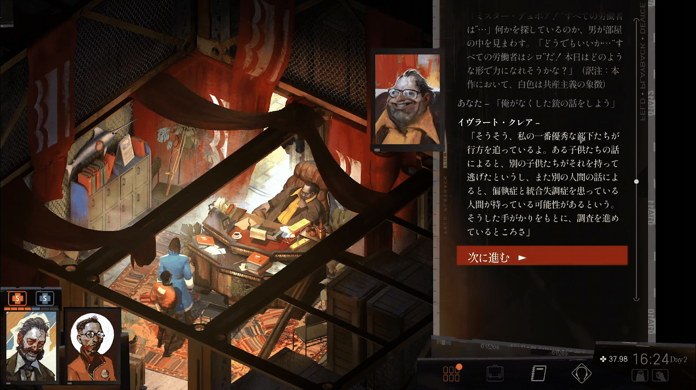
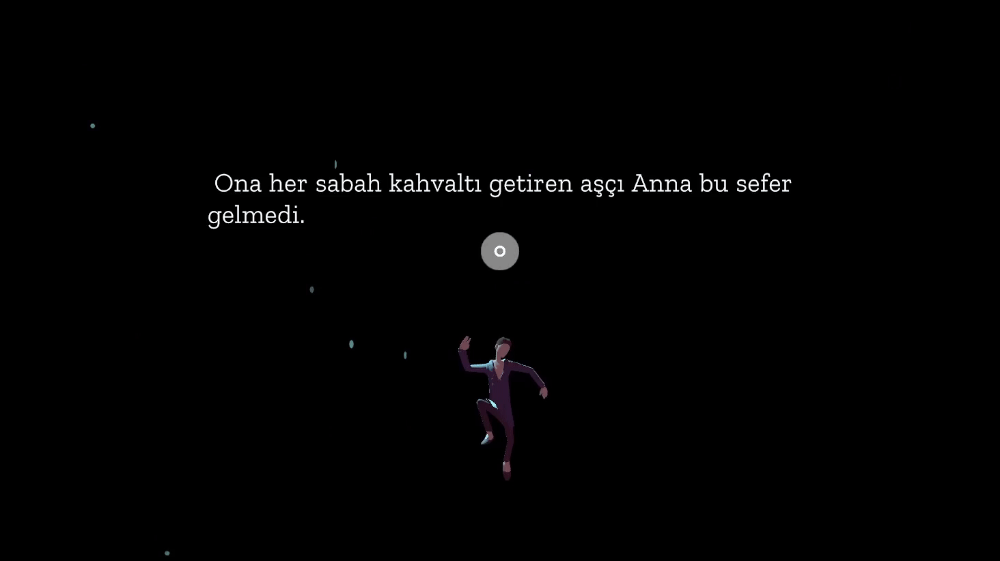

# Wordcel

Multilingual OCR popup dictionary for Windows and macOS. Look up screen or selected text, hear pronunciations, translate sentences and save words to Anki with context, screenshots and audio.

[Download](https://github.com/namidanokisetsu/wordcel/releases) · [Supported languages](docs/LANGUAGES.md) · [User guide](docs/USER_GUIDE.md) · [Report a bug](https://github.com/namidanokisetsu/wordcel/issues/new)

## Where to get dictionaries

For supported languages, built-in Wiktionary dictionary packs are available to download directly in the app. You can also import additional dictionaries, but only Yomitan-format dictionaries are supported.

Some sources for Yomitan dictionaries:
- Turkish: [Turkdict](https://github.com/namidanokisetsu/turkdict)
- Japanese, Chinese, Korean and other languages: [MarvNC's Yomitan dictionaries](https://github.com/MarvNC/yomitan-dictionaries)

## Contributing

Pull requests are welcome! Use [Issues](https://github.com/namidanokisetsu/wordcel/issues) for bug reports and feature requests, and [Discussions](https://github.com/namidanokisetsu/wordcel/discussions) for questions and feedback.

Fork of [rtr46/meikipop](https://github.com/rtr46/meikipop). GPL-3.0.
