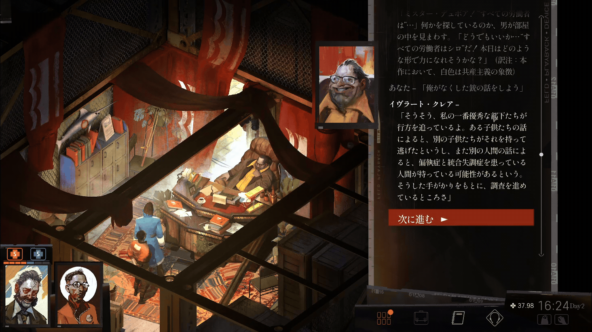
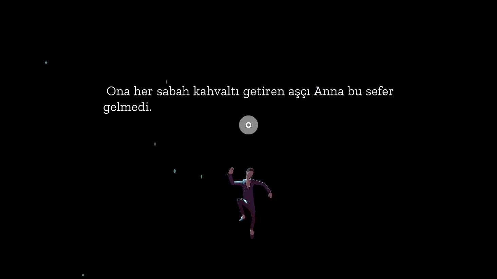

# Wordcel

Multilingual OCR popup dictionary for Windows and macOS. Look up screen or selected text, hear pronunciations, translate sentences and save words to Anki with context, screenshots and audio. Works fully offline after setup, with optional online recordings.

[Download](https://github.com/namidanokisetsu/wordcel/releases) · [Supported languages](docs/LANGUAGES.md) · [User guide](docs/USER_GUIDE.md)

## Where to get dictionaries

Try Yomitan dictionaries from:

- Turkish: [Turkdict](https://github.com/namidanokisetsu/turkdict) (Yomitan version!).
- Japanese, Chinese and other languages: [MarvNC's Yomitan dictionaries](https://github.com/MarvNC/yomitan-dictionaries).
- Other languages: built-in Wiktionary packs available to download in the app.

Fork of [rtr46/meikipop](https://github.com/rtr46/meikipop). GPL-3.0.
